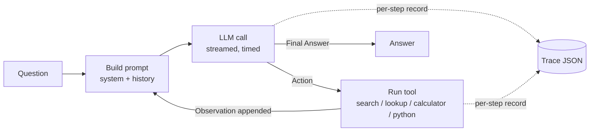

# agentic-profiling — backend

**Where does the time go when an LLM agent runs, and how much of its work is repeated?**

This project profiles *agentic* LLM workloads (multi-step ReAct agents that interleave
model calls with tool calls) from a systems perspective. Every step of every task is
instrumented: time to first token, generation time, tool latency, prompt and output
tokens, and how much of each prompt is a prefix that the model has already processed.
These traces are then used to evaluate serving-side optimizations such as **prefix
caching**, under single-agent and concurrent multi-agent load.

This repository is the **backend**: the agent, its tools, the instrumented LLM client,
the benchmark runner, the analysis and the API server. The results page and the live
"Ask the agent" UI are a separate React + Tailwind project:
**[frontend repository](https://github.com/Carlos28042003/agent-profilling-fontend)**.

> **Status:** Week 1 complete; Week 2 benchmarks (100 HotpotQA + 100 GSM8K tasks) running;
> analysis and serving-comparison tooling built. See [STATUS.md](STATUS.md).

---

## Contents

- [Motivation](#motivation)
- [Research questions](#research-questions)
- [Preliminary observation](#preliminary-observation)
- [How it works](#how-it-works)
- [Quick start](#quick-start)
- [Commands](#commands)
- [Working with the frontend](#working-with-the-frontend)
- [Repository layout](#repository-layout)
- [Configuration](#configuration)
- [Task files](#task-files)
- [Trace format](#trace-format)
- [Running against llama.cpp / vLLM / SGLang](#running-against-llamacpp--vllm--sglang)
- [Tools](#tools)
- [Reproducibility](#reproducibility)
- [Hardware](#hardware)
- [Roadmap](#roadmap)
- [Known limitations](#known-limitations)

---

## Motivation

LLM serving systems are mostly designed and benchmarked for single-turn chat: one
prompt in, one answer out. Agents behave differently. A ReAct agent calls the model
many times per task, and each call re-sends the entire history (system prompt, question,
every previous thought, action and tool observation) plus a small new piece. The
model's work therefore grows with the number of steps, while most of every prompt is
identical to the previous one.

This makes agents a natural target for KV-cache reuse, but it also raises systems
questions that chat benchmarks do not answer: how much time is spent in the model vs.
in tools, how fast the context grows, how much prefix caching actually helps end-to-end
latency, and what happens when many agents share one GPU.

## Research questions

1. **Time breakdown:** what fraction of an agent task's latency is LLM prefill, LLM
   decode, tool execution and framework overhead?
2. **Context growth:** how does the prompt length grow per step, and how does this
   differ between workloads (multi-hop retrieval vs. math)?
3. **Prefix reuse:** what fraction of input tokens at each step is a repeated prefix
   from earlier steps?
4. **Serving impact:** how much does prefix caching reduce TTFT and per-task latency,
   and increase throughput, for these workloads?
5. **Concurrency:** how do latency and throughput scale with several concurrent agents,
   and what does shortening the context cost when it breaks the cached prefix?

## Preliminary observation

A sanity-check run (local Ollama, `llama3.2:3b`, GTX 1650) on one smoke-test task
(`combo_1`: *"How many years passed between the founding of Google and the founding
of Microsoft?"*, 6 steps):

| Step | TTFT (s) | Decode (s) | Tool (s) | Prompt tokens | Cached prompt tokens |
|-----:|---------:|-----------:|---------:|--------------:|---------------------:|
| 0 | 2.51 | 1.03 | 1.15 |   248 |   228 |
| 1 | 4.06 | 1.26 | 1.27 |   584 |   277 |
| 2 | 4.15 | 1.67 | 1.23 |   928 |   622 |
| 3 | 4.26 | 1.40 | 1.14 | 1,283 |   977 |
| 4 | 4.36 | 1.53 | 0.00 | 1,635 | 1,322 |
| 5 | 2.42 | 1.53 | 0.00 | 1,691 | 1,676 |

The prompt grows by roughly 350 tokens per step, and from step 1 onward more than 90% of
each prompt is the previous step's prompt. Across the Week 1 smoke tests, prefill (TTFT)
takes about 60% of task time and decode about 25%. These are functional checks on a small
model, not final results.

## How it works



- **Hand-written ReAct loop** (`src/agentic_profiling/agent.py`). No agent framework, so
  every millisecond and every token can be attributed.
- **Append-only history.** The prompt of step *N* is an exact prefix of the prompt of step
  *N+1*: the property prefix caching exploits and the traces measure.
- **Instrumented LLM client** (`llm.py`). OpenAI-compatible Chat Completions with streaming:
  TTFT is the first content chunk; token usage (including cached tokens) comes from the
  final chunk. Works with Ollama, llama.cpp, vLLM and SGLang by changing `base_url`.
- **Stop sequences** (`Observation:`) prevent the model from inventing tool results.

## Quick start

Requirements: [uv](https://docs.astral.sh/uv/) and [Ollama](https://ollama.com).

```bash
uv sync                                   # Python 3.12 + exact versions from uv.lock
ollama pull llama3.2:3b
ollama create llama3.2:3b-ctx8k -f configs/ollama/llama3.2-ctx8k.Modelfile
uv run pytest                             # automated tests
uv run agentic-profiling configs/ollama.yaml tasks/smoke.yaml    # 5 smoke tasks
```

## Commands

| Command | What it does |
|---|---|
| `uv run agentic-profiling <config> <tasks> [--out DIR] [--limit N] [--concurrency N]` | Run tasks and write one JSON trace per task. Resumable: tasks that already have a trace are skipped |
| `uv run agentic-tasks hotpotqa\|gsm8k --n 100` | Build a task file from a public benchmark (fixed seed) |
| `uv run agentic-summary <trace dirs...>` | Per-run table: accuracy, steps, time split, prefix reuse, truncated steps |
| `uv run agentic-analyze <name> <trace dirs...>` | Characterization figures + `stats.json` in `results/figures/<name>/` |
| `uv run agentic-compare <name> <trace dirs...>` | Serving comparison: TTFT, latency, throughput, prefill tokens, cache hit |
| `uv run agentic-export <name> <trace dirs...> --title ... --description ...` | Save `results/<name>.json` and rebuild `results/data.json` (for the frontend) |
| `uv run agentic-ui [--site PATH] [--no-browser]` | API server (and the built frontend) on http://localhost:8000 |

Example output (a 6-task GSM8K pilot run):

```
[  4/6] [OK ] gsm8k_0079   3 steps   10.9s  tools=['calculator', 'calculator']  answer='70'
[  5/6] [OK ] gsm8k_0082   3 steps   10.7s  tools=['calculator', 'calculator']  answer='623'
...
5/6 correct — 6 tasks in 87s (4.1 tasks/min) — traces in traces/pilot/gsm8k
```

## Working with the frontend

The two repositories are meant to sit side by side in one folder:

```
agentic-profiling/
├── backend/     this repository
└── frontend/    the React + Tailwind repository
```

- **Data:** `agentic-export` writes `results/data.json`; in the frontend,
  `npm run sync-data` copies it and `npm run build` rebuilds the site.
- **Live agent:** `uv run agentic-ui` serves the API (`/api/health`, `/api/ask` with
  Server-Sent Events) and, if `../frontend/docs` exists, the built site at `/`. Use
  `--site PATH` for another location. For frontend development, run
  `uv run agentic-ui --no-browser` here and `npm run dev` in the frontend.

## Repository layout

```
src/agentic_profiling/
  agent.py       hand-written ReAct loop, per-step Step/Trace records
  tools.py       search + lookup (Wikipedia), calculator, python
  llm.py         streaming OpenAI-compatible client (TTFT, decode, tokens, cache)
  metrics.py     HotpotQA exact match / F1, numeric match
  benchmarks.py  agentic-tasks
  __init__.py    agentic-profiling (runner)
  summarize.py   agentic-summary
  analyze.py     agentic-analyze
  compare.py     agentic-compare
  export.py      agentic-export
  server.py      agentic-ui (FastAPI)
configs/         server + model + sampling parameters (Ollama, llama.cpp)
tasks/           smoke.yaml, hotpotqa_100.yaml, gsm8k_100.yaml
scripts/         serve_llamacpp.ps1 (llama.cpp server)
results/         exported experiments (JSON), data.json for the frontend, figures — tracked
traces/          raw traces — local only (git-ignored)
tests/           pytest suite
```

## Configuration

`configs/*.yaml`:

| Key | Default | Meaning |
|-----|---------|---------|
| `base_url` | (required) | OpenAI-compatible endpoint: Ollama `http://localhost:11434/v1`, llama.cpp `http://localhost:8080/v1`, vLLM `http://localhost:8000/v1` |
| `model` | (required) | Model name as known by the server |
| `api_key` | `unused` | Only needed for hosted APIs |
| `temperature` | `0.0` | Sampling temperature |
| `seed` | `0` | Sampling seed passed to the server |
| `max_tokens` | `512` | Maximum output tokens per LLM call |
| `max_steps` | `8` | Maximum ReAct steps per task |
| `history_window` | none | Keep only the last N steps in the prompt (context truncation experiment) |
| `extra_body` | none | Server-specific request options, e.g. `{cache_prompt: false}` for llama.cpp |

## Task files

`tasks/*.yaml` is a list of tasks:

```yaml
- id: hotpot_0115
  question: The Argentine PGA Championship record holder has won how many tournaments worldwide?
  expected: ['230']
  metric: hotpotqa                        # hotpotqa (EM/F1) | numeric | contains
  tools: [search, lookup, calculator]     # tools available for this task
```

`hotpotqa`: official normalized exact match and token F1. `numeric`: the last number in the
answer equals the expected number (GSM8K). `contains`: any expected string appears in the
answer (smoke tests).

## Trace format

One JSON file per task. Per-step fields:

| Field | Description |
|-------|-------------|
| `index`, `t_start` | Step number and start time (s since task start) |
| `llm_ttft_s` | Time to first token (≈ queueing + prefill) |
| `llm_generation_s` | Time from first token to end of stream (≈ decode) |
| `tool`, `tool_input`, `tool_s` | Tool called, its input and its latency |
| `step_total_s` | Whole step; `step_total_s − llm_total_s − tool_s` = overhead |
| `prompt_tokens`, `completion_tokens`, `cached_tokens` | Token usage reported by the server |
| `prompt_chars`, `shared_prefix_chars` | Prompt length and prefix shared with the previous step |
| `server_timings` | llama.cpp server-side timings (prefill/decode ms, cached tokens), when available |
| `output`, `observation` | Raw model output and tool result |

Each trace also stores the outcome (`answer`, `correct`, `em`, `f1`, `stop_reason`), the
full conversation (`messages`) and the run metadata (config, git commit, versions).

## Running against llama.cpp / vLLM / SGLang

The agent code does not change: only `base_url` and `model` in the config.

**llama.cpp (Windows or Linux, any NVIDIA GPU).** Reuses Ollama's GGUF file; prompt caching
can be switched off per request, which gives a clean on/off comparison:

```powershell
ollama stop llama3.2:3b-ctx8k            # free the GPU
.\scripts\serve_llamacpp.ps1             # or -Parallel 4 for 4 concurrent agents
uv run agentic-profiling configs/llamacpp.yaml         tasks/gsm8k_100.yaml --out traces/week4/cache-on
uv run agentic-profiling configs/llamacpp-nocache.yaml tasks/gsm8k_100.yaml --out traces/week4/cache-off
uv run agentic-compare week4 traces/week4/cache-on traces/week4/cache-off
```

**vLLM / SGLang (Linux, 24 GB GPU for 7-8B models).** Install each in its own virtual
environment:

```bash
vllm serve Qwen/Qwen2.5-7B-Instruct --port 8000                             # prefix caching on
vllm serve Qwen/Qwen2.5-7B-Instruct --port 8000 --no-enable-prefix-caching  # off
```

## Tools

| Tool | Input | Implementation |
|------|-------|----------------|
| `search` | Query (best: a name or title) | MediaWiki API: opens the best-matching page; returns its introduction and the titles of other matches |
| `lookup` | Keyword | Next sentence of the current page containing the keyword (as in the ReAct paper) |
| `calculator` | Arithmetic expression | Parsed with `ast` and checked against a whitelist, then evaluated with SymPy |
| `python` | Python code | Separate interpreter (`python -I -X utf8`) in a temporary directory, 10 s timeout |

HotpotQA tasks get `search`, `lookup` and `calculator`; GSM8K tasks get `calculator` and
`python`. Tool errors are returned to the agent as observations; tasks that hit network
errors are not saved, so a resumed run retries them.

## Reproducibility

- Exact dependencies in `uv.lock`; `temperature: 0` and a fixed `seed`; task files built
  with a fixed seed.
- Every run stores its config, git commit, Python version, platform and client version.
- Full conversations are stored in each trace, so token-level metrics can be recomputed.

## Hardware

| Stage | Hardware |
|-------|----------|
| Development, benchmarks, characterization, llama.cpp experiments | PC, 24 GB RAM, GTX 1650 (4 GB) |
| vLLM / SGLang measurements with 7-8B models (optional) | Rented 24 GB GPU (RTX 4090 / A5000 class) |

## Roadmap

- [x] **Week 1:** ReAct agent, tools, per-step instrumentation, trace format, smoke tests, run summary
- [ ] **Week 2:** HotpotQA and GSM8K, 100 tasks each, proper grading — *running*
- [ ] **Week 3:** Characterization: time breakdown, context growth, prefix reuse, latency CDF (tooling done)
- [ ] **Week 4:** Prefix caching on vs. off (llama.cpp; vLLM optional) (tooling done)
- [ ] **Week 5:** Concurrent agents and context truncation vs. cache reuse (tooling done)
- [ ] **Week 6:** 4-page report; final numbers here and on the results page

## Known limitations

- **Small-model accuracy.** The 3B models used on a 4 GB GPU answer multi-hop questions
  poorly; the study focuses on systems behaviour (time, tokens, cache), not accuracy.
- **The `python` tool is not a security sandbox**: it isolates the interpreter and limits
  run time, which is enough for math tasks.
- **Ollama's default context (4096 tokens) silently truncates long agent histories**, which
  drops the cached prefix (TTFT rose 4.4× in one trace). The configs use `num_ctx 8192`
  and `agentic-summary` flags truncated steps.
- **Wikipedia search** uses full-text search, which handles natural-language queries
  poorly; `lookup` helps the agent find facts inside a page.
- **`cached_tokens` semantics differ between servers**, so prefix reuse is also computed
  from the token counts of consecutive steps.
