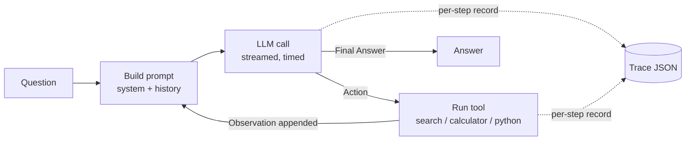

# agentic-profiling

**Where does the time go when an LLM agent runs, and how much of its work is repeated?**

This project profiles *agentic* LLM workloads (multi-step ReAct agents that interleave
model calls with tool calls) from a systems perspective. Every step of every task is
instrumented: time to first token, generation time, tool latency, prompt and output
tokens, and how much of each prompt is a prefix that the model has already processed.
These traces are then used to evaluate serving-side optimizations such as **prefix
caching** in vLLM and **RadixAttention** in SGLang, under single-agent and concurrent
multi-agent load.

> **Status:** Week 1 of 8 complete. The agent, tools, instrumentation and trace format
> are done and tested. Benchmarks (HotpotQA, GSM8K), characterization and the vLLM/SGLang
> comparison are in progress. See the [roadmap](#roadmap).

---

## Table of contents

- [Motivation](#motivation)
- [Research questions](#research-questions)
- [Preliminary observation](#preliminary-observation)
- [How it works](#how-it-works)
- [Repository layout](#repository-layout)
- [Installation](#installation)
- [Usage](#usage)
- [Web interface and results page](#web-interface-and-results-page)
- [Configuration](#configuration)
- [Task files](#task-files)
- [Trace format](#trace-format)
- [Running against vLLM / SGLang](#running-against-vllm--sglang)
- [Tools](#tools)
- [Reproducibility](#reproducibility)
- [Hardware](#hardware)
- [Roadmap](#roadmap)
- [Known limitations](#known-limitations)

---

## Motivation

LLM serving systems are mostly designed and benchmarked for single-turn chat: one
prompt in, one answer out. Agents behave differently. A ReAct agent calls the model
many times per task, and each call re-sends the entire history (system prompt, question,
every previous thought, action and tool observation) plus a small new piece. The
model's work therefore grows with the number of steps, while most of every prompt is
identical to the previous one.

This makes agents a natural target for KV-cache reuse, but it also raises systems
questions that chat benchmarks do not answer: how much time is spent in the model vs.
in tools, how fast the context grows, how much prefix caching actually helps end-to-end
latency, and what happens when many agents share one GPU.

## Research questions

1. **Time breakdown:** what fraction of an agent task's latency is LLM prefill, LLM
   decode, tool execution and framework overhead?
2. **Context growth:** how does the prompt length grow per step, and how does this
   differ between workloads (multi-hop retrieval vs. math/code)?
3. **Prefix reuse:** what fraction of input tokens at each step is a repeated prefix
   from earlier steps?
4. **Serving impact:** how much do prefix caching (vLLM) and RadixAttention (SGLang)
   reduce TTFT, per-task latency and increase throughput for these workloads?
5. **Concurrency:** how do latency and throughput scale with 8 / 16 / 32 concurrent
   agents, and can request scheduling or asynchronous tool execution improve them?

## Preliminary observation

A sanity-check run (local Ollama, `llama3.2:3b`, GTX 1650) on one smoke-test task
(`combo_1`: *"How many years passed between the founding of Google and the founding
of Microsoft?"*, 6 steps) already shows the pattern this project studies:

| Step | TTFT (s) | Decode (s) | Tool (s) | Prompt tokens | Cached prompt tokens |
|-----:|---------:|-----------:|---------:|--------------:|---------------------:|
| 0 | 2.51 | 1.03 | 1.15 |   248 |   228 |
| 1 | 4.06 | 1.26 | 1.27 |   584 |   277 |
| 2 | 4.15 | 1.67 | 1.23 |   928 |   622 |
| 3 | 4.26 | 1.40 | 1.14 | 1,283 |   977 |
| 4 | 4.36 | 1.53 | 0.00 | 1,635 | 1,322 |
| 5 | 2.42 | 1.53 | 0.00 | 1,691 | 1,676 |

The prompt grows by roughly 350 tokens per step, and from step 1 onward more than
90% of each prompt is the previous step's prompt. These numbers come from a single
task on a small model. They are a functional check, not a result.

## How it works



- **Hand-written ReAct loop** (`agent.py`). No agent framework, so that every
  millisecond and every token can be attributed. The model replies in the
  `Thought / Action / Action Input` format; the loop parses it, runs the tool and appends
  `Observation: ...` as a new message.
- **Append-only history.** Messages are only ever appended, never rewritten. The
  prompt of step *N* is therefore an exact prefix of the prompt of step *N+1*, which is
  the property that prefix caching exploits and that the traces measure
  (`shared_prefix_chars`, `cached_tokens`).
- **Instrumented LLM client** (`llm.py`). It uses the OpenAI-compatible Chat Completions
  API with streaming, so TTFT is measured as the arrival of the first content chunk, and
  token usage (including `cached_tokens` when the server reports it) is read from the
  final chunk. The same client works with Ollama, vLLM and SGLang by changing `base_url`.
- **Stop sequences** (`Observation:`) prevent the model from hallucinating tool
  results.

## Repository layout

```
agentic-profiling/
├── src/agentic_profiling/
│   ├── __init__.py     CLI: runs a task file, writes one trace per task + run metadata
│   ├── agent.py        ReAct loop, Step / Trace dataclasses, prefix measurement
│   ├── llm.py          streaming OpenAI-compatible client: TTFT, decode time, tokens
│   ├── tools.py        search (Wikipedia), calculator, python
│   ├── summarize.py    agentic-summary: per-run table (accuracy, time split, prefix reuse)
│   ├── export.py       agentic-export: results/<name>.json + DATA of the results page
│   └── server.py       agentic-ui: local web server (results page + live "Ask" tab)
├── docs/
│   └── index.html      results page (React + Tailwind, no build step; GitHub Pages)
├── results/            exported experiment results (JSON, tracked by git)
├── tests/              pytest suite (tools, ReAct loop with a fake LLM, truncation detection)
├── configs/
│   ├── ollama.yaml     llama3.2:3b (8k context), sampling parameters
│   ├── ollama-qwen.yaml qwen2.5:3b (8k context)
│   └── ollama/         Modelfiles that raise Ollama's context to 8192 tokens
├── tasks/
│   └── smoke.yaml      5 smoke-test tasks (one per tool, multi-hop, combined)
├── requirements/       human-readable dependency lists
│   ├── base.txt        runtime dependencies (also in pyproject.toml / uv.lock)
│   ├── dev.txt         pytest, ruff, ipykernel
│   ├── gpu.txt         vLLM server (Linux + NVIDIA GPU, separate venv)
│   └── sglang.txt      SGLang server (Linux + NVIDIA GPU, separate venv)
├── ESTADO.md           working notes: progress, known issues, next steps
├── pyproject.toml
└── uv.lock             exact pinned versions
```

`traces/` (run output) is created at run time and is not tracked by git.

## Installation

Requirements: Linux (recommended) or Windows, Python 3.12, [uv](https://docs.astral.sh/uv/),
and an LLM server with an OpenAI-compatible API ([Ollama](https://ollama.com) for local
development).

```bash
# 1. uv
curl -LsSf https://astral.sh/uv/install.sh | sh

# 2. Code and environment (installs the exact versions from uv.lock)
git clone https://github.com/Carlos28042003/agent-profilling.git
cd agent-profilling
uv sync

# 3. A local model for development
curl -fsSL https://ollama.com/install.sh | sh
ollama pull llama3.2:3b
```

## Usage

```bash
uv run agentic-profiling <config.yaml> <tasks.yaml> [--out <dir>]
```

Example:

```bash
uv run agentic-profiling configs/ollama.yaml tasks/smoke.yaml
```

Output (one line per task, then a summary):

```
[OK ] calc_1       3 passos   10.1s  ferramentas=['calculator']  resposta='7097663'
[OK ] combo_1      6 passos   35.0s  ferramentas=['search', 'search', 'search', 'search', 'calculator']  resposta='23'
...
3/5 corretas — traces em traces/ollama-smoke-20261018T105312Z
```

Each run writes a directory `traces/<config>-<tasks>-<UTC timestamp>/` containing
`run_meta.json` and one `<task_id>.json` per task.

## Web interface and results page

```bash
uv run agentic-ui          # opens http://localhost:8000
```

The page has three tabs:

- **Results**: summary tiles, prompt-vs-cache chart for one task, time breakdown per run,
  the full runs table and correct answers per task. All numbers come from the `DATA`
  object in `docs/index.html`.
- **Ask the agent** (local only): type any question, pick a model and watch the agent
  work live. Each step shows the thought, the tool call, the observation, TTFT,
  generation and tool time, prompt tokens and cache hit. Every question is saved as a
  trace in `traces/ask/`.
- **About**: what the project measures and how to run it.

The same `docs/index.html` is published with **GitHub Pages** (Settings → Pages → branch
`main`, folder `/docs`). There it shows the Results and About tabs; the Ask tab needs the
local Python server and Ollama.

To publish a new experiment on the page:

```bash
uv run agentic-summary traces/<experiment>/*            # check the numbers
uv run agentic-export <name> traces/<experiment>/*     --title "Short title" --description "One paragraph for the page"
git add results docs && git commit -m "Results: <name>" && git push
```

`agentic-export` writes `results/<name>.json` and rebuilds `DATA` from every file in
`results/`. Use `--example <run>/<task_id>` to choose the task shown in the step chart
(default: the longest task that was answered correctly).

## Configuration

`configs/*.yaml`:

| Key | Default | Meaning |
|-----|---------|---------|
| `base_url` | (required) | OpenAI-compatible endpoint, e.g. `http://localhost:11434/v1` (Ollama), `http://localhost:8000/v1` (vLLM) |
| `model` | (required) | Model name as known by the server (`llama3.2:3b`, `Qwen/Qwen2.5-7B-Instruct`, …) |
| `api_key` | `unused` | Only needed for hosted APIs |
| `temperature` | `0.0` | Sampling temperature (0 for reproducibility) |
| `seed` | `0` | Sampling seed passed to the server |
| `max_tokens` | `512` | Maximum output tokens per LLM call |
| `max_steps` | `8` | Maximum ReAct steps before the task is stopped (`stop_reason = "max_steps"`) |

## Task files

`tasks/*.yaml` is a list of tasks:

```yaml
- id: multihop_1
  question: In which country was the director of the film "Inception" born?
  expected: ["United Kingdom", "England", "UK", "London", "British"]
```

`expected` is a list of accepted answers. A task counts as correct if any of them
appears in the agent's final answer (case-insensitive). This check is a placeholder and
will be replaced by benchmark-specific metrics (see [limitations](#known-limitations)).

## Trace format

One JSON file per task. Top-level fields:

| Field | Description |
|-------|-------------|
| `task_id`, `question`, `expected` | Task definition |
| `answer`, `correct`, `finished`, `stop_reason` | Outcome (`final_answer` or `max_steps`) |
| `total_s` | Wall-clock time of the whole task |
| `steps` | List of per-step records (below) |
| `messages` | The full final conversation, so prompts can be re-tokenized offline |
| `meta` | Copy of `run_meta.json` |

Per-step fields:

| Field | Description |
|-------|-------------|
| `index`, `t_start` | Step number and start time (s since task start) |
| `llm_ttft_s` | Time to first token (≈ queueing + prefill) |
| `llm_generation_s` | Time from first token to end of stream (≈ decode) |
| `llm_total_s` | Total LLM call time |
| `tool`, `tool_input`, `tool_s` | Tool called, its input and its latency |
| `step_total_s` | Whole step; `step_total_s − llm_total_s − tool_s` = overhead |
| `prompt_tokens`, `completion_tokens` | Token usage reported by the server |
| `cached_tokens` | Prompt tokens served from the server's KV cache, if reported |
| `prompt_chars` | Length of the rendered prompt |
| `shared_prefix_chars` | Length of the prefix shared with the previous step's prompt |
| `output`, `observation` | Raw model output and tool result |

Excerpt of one step (`tool_input`, `output` and `observation` omitted):

```json
{
  "index": 3,
  "llm_ttft_s": 4.26,
  "llm_generation_s": 1.40,
  "tool": "search",
  "tool_s": 1.14,
  "prompt_tokens": 1283,
  "completion_tokens": 40,
  "cached_tokens": 977,
  "prompt_chars": 5974,
  "shared_prefix_chars": 4261
}
```

`run_meta.json` records the config, the task file, the start time, the git commit,
the Python version, the platform and the `openai` client version.

## Running against vLLM / SGLang

The agent code does not change: only `base_url` and `model` in the config. vLLM and
SGLang require Linux and an NVIDIA GPU (24 GB is enough for 7-8B models). Install each
in its **own virtual environment**, since they pin different PyTorch versions:

```bash
uv venv ~/venvs/vllm && source ~/venvs/vllm/bin/activate
uv pip install -r requirements/gpu.txt

# prefix caching ON (default in vLLM V1)
vllm serve Qwen/Qwen2.5-7B-Instruct --port 8000
# prefix caching OFF
vllm serve Qwen/Qwen2.5-7B-Instruct --port 8000 --no-enable-prefix-caching
```

Then create `configs/vllm.yaml`:

```yaml
base_url: http://localhost:8000/v1
model: Qwen/Qwen2.5-7B-Instruct
temperature: 0.0
seed: 0
max_tokens: 512
max_steps: 8
```

and run:

```bash
uv run agentic-profiling configs/vllm.yaml tasks/smoke.yaml
```

On GPUs without bf16 support (e.g. GTX 16xx), add `--dtype half` and use a small model
(e.g. `Qwen/Qwen2.5-0.5B-Instruct`) only to test the setup.

## Tools

| Tool | Input | Implementation |
|------|-------|----------------|
| `search` | Search query | MediaWiki API: plain-text intro of the best match + snippets of the next 3 results (max 1,500 chars) |
| `calculator` | Arithmetic expression | Parsed with `ast` and checked against a whitelist of node types and function names (`sqrt`, `log`, `sin`, …), then evaluated with SymPy |
| `python` | Python code | Runs in a separate interpreter (`python -I -X utf8`) in a temporary directory with a 10 s timeout; stdout (and stderr on failure) is returned |

Tool errors (network failures, invalid expressions, timeouts) are returned to the agent
as observations instead of crashing the run, as in real agent deployments.

## Reproducibility

- Exact dependency versions are pinned in `uv.lock` (`uv sync` reproduces the environment).
- `temperature: 0` and a fixed `seed` in every config.
- Every run stores its config, git commit, Python version, platform and client version.
- Full conversations are stored in each trace, so all token-level metrics can be
  recomputed offline with the model's tokenizer.

## Hardware

| Stage | Hardware |
|-------|----------|
| Development, smoke tests, characterization with Ollama | Linux, 24 GB RAM, GTX 1650 (4 GB) |
| vLLM / SGLang measurements with 7-8B models | Rented 24 GB GPU (RTX 4090 / A5000 class) |

## Roadmap

- [x] **Week 1:** ReAct agent, 3 tools, per-step instrumentation, trace format, 5 smoke tasks, tests, run summary (3 runs × 2 models)
- [ ] **Week 2:** HotpotQA and GSM8K loaders, 100-task runs, proper accuracy metrics
- [ ] **Week 3:** Characterization: time breakdown, context growth, prefix-reuse fraction, step count and latency distributions (P50/P95), plots
- [ ] **Week 4:** vLLM with prefix caching on vs. off (TTFT, per-task latency, throughput); SGLang RadixAttention if time permits
- [ ] **Week 5:** 8 / 16 / 32 concurrent agents; one optimization with measured gain and trade-off (async tool execution, cache-aware scheduling, or context truncation)
- [ ] **Week 6:** 4-page report and final results in this README

## Known limitations

- **The `python` tool is not a security sandbox.** It isolates the interpreter and
  limits run time, which is enough for math tasks; code benchmarks (e.g. SWE-bench) will
  run it inside a network-less container.
- **Small-model accuracy.** With `llama3.2:3b` the agent solves 3-4 of 5 smoke tasks
  (3 runs); search, calculator and code tasks always succeed, while the multi-hop task
  always fails because the model drifts to similar-looking pages. The main experiments
  use 7-8B models.
- **Ollama's default context (4096 tokens) silently truncates long agent histories**,
  which drops the cached prefix (TTFT rose 4.4× in one trace). The configs use
  `num_ctx 8192` (`configs/ollama/*.Modelfile`) and `agentic-summary` flags truncated steps.
- **Wikipedia search** uses full-text search, which handles natural-language queries
  poorly. A `lookup` tool (search within the current page, as in the original ReAct
  paper) is planned for HotpotQA.
- **Answer checking** is substring matching for now; it will be replaced by normalized
  exact match / F1 (HotpotQA) and numeric comparison (GSM8K).
- **`cached_tokens` semantics differ between servers** (Ollama vs. vLLM), so prefix reuse
  is also computed offline from the stored conversations.
